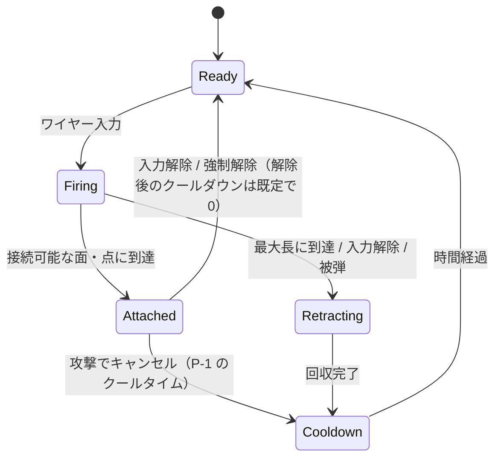

# 01. ゲーム基本仕様（設計書）

> ステータス: ドラフト v0.2（2026-10-13、空中戦のテーマ、撃破の条件、地上技、ガードの仕様をユーザーの決定で更新）
> 表記ルール:
> - **【仮】** = プロトタイプ用の仮値・仮仕様。プレイテストで調整する前提で、最終仕様ではない
> - **【未決 D-xx】** = [02_open_decisions.md](02_open_decisions.md) の判断事項 D-xx に依存する
> - **【提案】** = Claude からの設計提案。承認されるまでは確定扱いにしない

---

## 1. コンセプト

| 項目 | 内容 |
|---|---|
| ジャンル | 2.5D横視点 ワイヤーアクション オンラインPvP |
| テーマ | **空中戦**（1.2。ユーザーの方針） |
| 人数 | 1試合4人（基本は個人戦。チーム戦は【未決 D-27】） |
| 試合時間 | 【仮】3分 |
| 勝利条件 | 制限時間終了時のスコア（コイン）最多 |
| 対象プラットフォーム | 【未決 D-03】（PC / Windows を第一候補として想定） |
| オンライン | プレイヤーホスト型。同期は決定論的ロールバック（全員が入力だけを送り合い、同じ計算をする。D-14） |
| 一言で | 「ワイヤーで飛び回り、殴ってコインを落とさせ、拠点で確定させる」【提案】 |

### 1.1 4つの面白さを1つのループに統合する【提案】

4要素（コイン争奪・空中コンボ・キャラクター対戦・目標争奪）を別モードにせず、次の因果でつなぐ。経済モデルの選択は【未決 D-24】。

```
           ┌──────────── ワイヤー移動（すべての土台） ────────────┐
           ▼                        ▼                           ▼
     [コイン争奪]              [空中コンボ]                 [目標争奪]
  フィールドのコインを      当てると相手の所持コインが     バンク地点で所持コインを
  拾う → 所持コイン         ドロップ → 拾った者のもの      確定コインに変える（争奪点）
           ▲                        ▲                           ▲
           └──── [キャラクター対戦] キャラごとに得意な「稼ぎ方」が違う ────┘
```

- **移動がすべての土台**: コインの回収速度、コンボの始動と追撃、拠点への到達と離脱は、どれもワイヤー移動の巧さで決まる。
- **戦闘でコインを稼げる**: ダメージや撃破でコインを獲得する（生成）。戦闘を起こすこと自体に価値を持たせる（P-4 のユーザー決定）。戦闘以外の稼ぎは、フィールドコインとハプニングイベントで補う（検討中）。
- **目標地点は「確定」の場所**: 所持コインは奪われうる未確定の財産。バンク地点で確定させる必要があり、そこにリスク（滞在中に狙われる）とリターン（失わなくなる）が集中する。
- **キャラ差は稼ぎ方の差**: 機動型は回収と逃げ、近接型はドロップの奪取、など。

### 1.2 テーマは「空中戦」（ユーザーの方針、2026-10-13）

空中を飛び回って戦うことがこのゲームの中心。設計の判断に迷ったら、空中機動が楽しくなる方を選ぶ。

- **地上に居座る利点をなくす**: 地上の攻撃は「地上技」1つだけ（6.1）。地上技は移動距離に優れ、最後に地面を離れて空中に移るように作る（キャラクターを作るときの方針。仕組みで強制はしない）ので、「素早く空中を動くために一度地上に降りる」という選択肢になる。
- **ステージは地上の部分を少なくする**: 足場は小さく少なめにし、空中機動が楽しくなるギミック（接続点、障害物など）を置く（4章、Phase 6）。下や横はステージの外で、外に出ると撃破される（6.8）。
- **コインは基本的に空中に浮かべて置く**（3.3）。
- **撃破はステージの外に出たとき**（HP はない。6.8）。吹き飛ばしと、ワイヤーでの復帰の攻防になる。

---

## 2. 試合の流れ

1. 4人がアリーナ内の別々の出現地点から開始する。
2. フィールドに一定間隔でコインが出現する。
3. プレイヤーはコインを拾い（所持コイン）、戦い（相手の所持コインをドロップさせ）、バンク地点で確定させる。
4. ステージの外に出たプレイヤーは撃破され（6.8）、【仮】3秒後に出現地点から復帰する（復帰直後は【仮】1.5秒無敵）。
5. 終盤（【仮】残り30秒）はコイン出現量とバンク速度が上がる。
6. 時間切れでスコアを集計し、順位を決める。同点の扱いは【未決】（案: 確定コインが多い方を上位）。

---

## 3. コイン・スコア設計（仮案: バンク型）【提案】

### 3.1 概念の区別

コインの「獲得」「所持」「ドロップ」「消滅」「最終スコアへの反映」を別々の概念として扱う。

| 概念 | 定義 | 失う条件 |
|---|---|---|
| フィールドコイン | マップ上に実体として存在し、拾えるコイン。定期出現分とドロップ分がある | 寿命切れで消滅 |
| 所持コイン | プレイヤーが持っている未確定のコイン | 被弾・撃破でドロップ |
| 確定コイン | バンクで確定済みのコイン。失わない | なし |
| スコア | 試合終了時の順位計算に使う値。確定コイン＋所持コイン【未決 D-25】 | — |

### 3.2 コインの取引（すべて台帳経由）

コインの増減は、シミュレーションの中の**コイン台帳（CoinLedger）**だけが実行する（ロールバック方式では全員が同じ台帳を計算し、確定ティックの値を正とする。D-14）。各取引には一意のイベントIDを付け、同じIDの二重適用を拒否する。

| 取引 | 種類 | 増減 |
|---|---|---|
| 出現（Spawn） | 生成 | フィールド＋ |
| 拾得（Pickup） | 移動 | フィールド → 所持 |
| 被弾ドロップ（HitDrop） | 移動 | 所持 → フィールド |
| 撃破ドロップ（KoDrop） | 移動 | 所持 → フィールド |
| 確定（Bank） | 移動 | 所持 → 確定 |
| ダメージ報酬（DamageReward） | 生成（上限・減衰あり） | → 攻撃者の所持 |
| 撃破報酬（KoReward） | 生成（上限・減衰あり） | → 攻撃者の所持 |
| 消滅（Expire） | 破棄 | フィールド − |

「生成」「破棄」以外の取引ではコインの総量が保存される。これを自動テストの不変条件として検証する。

### 3.3 ルール（数値はすべて【仮】）

- **定期出現**: 複数の出現地点から10秒ごとに出現する。出現地点は**基本的に空中**（空中戦のテーマ。1.2）。危険な場所や到達が難しい場所ほど高額。
- **被弾ドロップ**: コンボの最初の被弾時に所持コインの10%（上限あり）をドロップする。同じコンボ中の追加ドロップはない（長いコンボで全額を失わないため）。
- **撃破ドロップ**: 撃破時に所持コインの50%をドロップする。
- **ドロップコイン**: 0.5秒間は誰も拾えない。その後は誰でも拾える（攻撃者に短い優先権を与えるかは【未決】）。寿命は10秒。
- **ダメージ報酬**: 与えたダメージに応じてコインを生成し、攻撃者の所持コインに加える。同じ相手から短時間に得られる量には上限を設け、繰り返すほど減衰させる。**HP はなく、ダメージはこのコインへの変換にだけ使う**（D-23、2026-10-13 ユーザー）。
- **撃破報酬**: 撃破した攻撃者にコインを生成して与える。被撃破者の順位が高いほど増額する（首位への賞金）。同じ相手を短時間に繰り返し撃破すると減衰し、30秒以内の再撃破はほぼ0。
- **ハプニングイベント**: 戦闘以外の稼ぎを増やすための、試合中に起きるイベント（ユーザーが検討中。Phase 4 以降）。
- **バンク地点**: 同時に1〜2か所がアクティブで、40秒ごとに移動する（移動先は10秒前に予告）。地点内に滞在している間、所持コインが毎秒5枚ずつ確定コインに移る。敵が同時に地点内にいると確定は止まる（争奪）。
- **終盤イベント**: 残り30秒でコイン出現量とバンク速度が上がる。

### 3.4 要件との対応

| 要件 | この案での担保 |
|---|---|
| 戦闘を避けて回収するだけの戦術にも意味がある | フィールドコイン、バンク、ハプニングイベントで稼げる。ワイヤー移動の巧さで戦闘を回避できる。戦闘報酬との比率は計測して調整する |
| 戦闘で有利になった者が無制限に有利になり続けない | 所持コインは確定しないと奪われうる。首位には撃破報酬が上乗せされ、狙われやすい |
| 同じ相手への攻撃・連続撃破による悪用を抑える | 同じ相手からのダメージ報酬・撃破報酬は上限と減衰あり、ドロップは1コンボ1回、復帰直後は無敵 |
| 目標地点を確保するリスクとリターンが成立する | 確定中は地点から動けず狙われる。確定すれば失わない |
| 終盤でも逆転の可能性が残る | 終盤イベント、首位への賞金、所持コインのドロップ |
| 報酬の発生と加算を一元管理する | シミュレーション内の CoinLedger に一本化。イベントIDで冪等にし、総量保存をテストする |

代替案（拠点を占拠するとコインが生成される型など）は [02 の D-24](02_open_decisions.md) を参照。

---

## 4. 空間設計（2.5D）【提案】

### 4.1 基本方針: 「ゲームプレイは平面、見た目は3D」

- **ゲームプレイ平面は XY**（X = 横、Y = 縦）。キャラクター、ワイヤー、攻撃判定、コイン、バンク地点はすべて Z = 0 の平面上で成立する。
- 奥行き（Z）は**見た目専用**（背景、前景、パララックス、ライティング）。
- 4人が入り乱れる対戦で「当たったか当たっていないか」が一目で分かることを最優先する。奥行きのあいまいさは視認性を大きく損なうため、初期は使わない。

### 4.2 後から変えやすくする仕組み

- シミュレーションは座標を3次元ベクトルで持つ。現在は Z = 0 に固定している。奥行きが必要になった時点（D-12 の変更時）に、次の `DepthPolicy`（データ）を導入する（未確定の機能を先回りして作らないため）。
  - `zRange`: 移動できる奥行きの範囲（初期値 0 = 完全平面）
  - `attackDepthTolerance`: 攻撃が成立する奥行きの差（初期値は zRange 以上 = 実質2D）
  - `zSnapMode`: レーン制などにする場合の吸着ルール
- 衝突判定は XY 平面上の軸平行の箱で行う（Core の `BoxTerrain`。Unity の物理クエリは使わない。D-32）。シーンの地形コライダーは Z 方向に厚みを持たせ、Z = 0 の面を横切るように置く。
- レーン制や浅い自由奥行きに変える場合も、移動・ワイヤー・判定のインターフェースは変えずにデータで切り替える（【未決 D-12】）。

### 4.3 ターゲット選択と画面外の把握

- ワイヤーは「照準方向＋エイムアシスト」で接続先を決める（5章）。
- 攻撃は向いている方向と入力方向で決まり、相手を自動では追尾しない（【仮】）。
- 画面外の相手は、画面端のインジケーター（方向・距離・所持コインの量）で示す。
- カメラの方式（自キャラ追従＋動的ズーム／全員を収める共有フレーミング）は【未決 D-13】。

---

## 5. キャラクター移動とワイヤー

### 5.1 基本移動（数値はすべて【仮】）

| 項目 | 仮仕様 |
|---|---|
| 走行 | 最高速 8 m/s。地上加速 80 m/s²、空中加速 30 m/s² |
| ジャンプ | 初速 12 m/s（高さ約2.4m）。空中ジャンプ1回。ワイヤーの接続を解除すると回復する（外れた場合は回復しない。ユーザーの指示、2026-10-12） |
| 重力 | 30 m/s²。最大落下速度 20 m/s |
| 壁 | 壁との接触を検出する。壁ずり・壁ジャンプは【未決】 |
| キャラ同士 | 押し合いなし（すり抜ける）。プラットフォーム対戦ゲームの一般的な扱い |
| 当たり形状 | 軸平行の箱（幅0.8m、高さ1.8m）。スイープを厳密に計算できるため（実装時に変更。地形との判定は D-32） |

### 5.2 ワイヤーのフェーズ（2タイプ共通）



| フェーズ | 内容 |
|---|---|
| Ready | 射出できる |
| Firing | フックが照準方向へ飛んでいる（弾速あり【仮】。即着弾にするかは【未決 D-10】）。攻撃でキャンセルできない |
| Attached | **接続中**。ワイヤーがオブジェクトと接続している状態で、これを「ワイヤーで引っ張られている状態」とする（D-18 決定）。この間だけワイヤー→攻撃のキャンセルができる。運動はワイヤーモデル（A/B）が計算する |
| Retracting | 外れたフックを回収中（短い隙） |
| Cooldown | 再射出までの待ち時間。外れた後（回収後）に入る。接続の解除後は既定で入らない（`ReleaseCooldownTicks` = 0。ユーザーの指示、2026-10-12） |

- **接続対象**: 「接続可能」属性を持つ地形面とアンカーポイント（【未決 D-09】）。プレイヤーへの接続は初期は不可（【未決】、ネットワーク予測が難しくなるため。[04](04_network.md) 参照）。
- **エイムアシスト**: 照準方向から【仮】±6°以内の接続可能点を優先する（プレイテスト 2026-10-13 を受けて ±12° から小さくした。ユーザーの決定）。
- **操作**: ボタンを押すと射出し、押している間は接続を維持し、離すと解除する（保持式【仮】、【未決 D-07】）。
- **解除後の慣性**: 解除時の速度を引き継ぐ。ただしタイプ共通の「出口速度上限」で制限する。
- **解除後の空中ジャンプ**: 接続を解除すると、空中ジャンプの回数が回復する（機動力のため。ユーザーの指示、2026-10-12）。
- **接続中の入力の影響【試行】**: 接続中にスティックを「進む方向」に入れると少し速く、逆向きに入れると少し遅くなる（最大 ±25%【仮】）。進む方向はタイプが決める（B: 接続点へ向かう方向）。タイプA は従来どおり、スティックで振りに力を加える。調整値を 0 にすると無効（ユーザーの指示、2026-10-12。強さはユーザーの確認で「ちょうどいい」）。
- **強制解除**: 被弾、最大接続時間【仮】3秒、アンカーの消失。ロープが地形に遮られたときは解除しない。
- **ロープの巻き付き【試行、D-33】**: ロープが地形の角に掛かると、角が新しい支点になり、そこを中心に振れる（残りのロープは短くなる）。巻き付いたときと反対側へ戻るとほどける。支点は最大4つ。巻き付けられないとき（支点が多すぎる）は、ロープが地形を通り抜ける。両タイプ共通（運動モデルは今の支点と残りのロープの長さだけを使う）。
- **外れたときの表示**: 届かなかった、または接続できない地形に当たったときは、外れた位置に×印と「MISS」を出し、フックが戻ってくる様子を描く（ボタンを離して途中でやめたときは「CANCEL」）。

### 5.3 2つのワイヤータイプ

接続中の運動計算だけを差し替え可能にする。フェーズ管理・照準・接続判定・解除・キャンセル規則・ネットワーク同期は**完全に共通**で、タイプごとのコード複製は行わない。

| | A. 物理・慣性重視 | B. 操作追従重視 |
|---|---|---|
| 接続中の運動 | ロープ長の拘束＋重力による振り子運動。巻き取るとロープが縮み、角運動量で加速する。遅い状態で接続した直後は、速さの下限（14 m/s【仮】）まで接続点の方向へ強く引く（下記） | アンカーへ向かう目標速度に素早く収束する。スティックで進路を横にずらせる |
| 面白さ | 軌道を理解し、速度を「育てる」。上手いほど速い | 狙った場所へ確実に、すぐ行ける |
| 上限 | 共通の最高速上限・出口速度上限に従う | 同左。上限はAより低めに設定する【仮】 |
| 想定する強み | 最高速、長距離の移動、コイン回収 | 接近の確実さ、コンボ追撃、狭い場所での機動 |

- 両タイプは同じルール・戦闘・スコア・ネットワーク仕様を共有する。
- どちらかが単純に上位互換にならないよう、**得意分野の違い**として性能差を作り、計測（コースタイム、接近成功率、勝率）で検証する（[07](07_quality.md)）。
- タイプの選び方（キャラ選択時、キャラ固有、試合設定）は【未決 D-11】。候補と利点・欠点は 02 に記載。
- **タイプA の検討の経緯（2026-10-12）**: 振り子が「B の初速が遅いだけ」に感じられたため、円運動（接続した瞬間の向きへ一定の速さで回る）を試した。触って比べた結果、ユーザーの判断で振り子に戻した。振り子の操作感は良く、気になるのは止まった状態から接続したときの初速だけだったため、そこだけを補った: 接続した瞬間の速さが下限（14 m/s【仮】）より遅いときは、接続直後の約0.33秒は下限を保つように接続点の方向へ強く引き、その後の約0.33秒で通常の巻き取りへなめらかに戻す。引きの間はロープがたるまない。振りが速くなれば、その時点で通常に戻る。
- **接続中の上下の入力**（D-41、2026-10-13 ユーザーの要望）: 下を押し続けると、ロープの長さを保ったまま振れる（巻き取らない）。上を押し続けると、ロープが素早く縮む（【仮】20 m/s）。何も押さなければ今までどおりの速さで巻き取る。

---

## 6. 戦闘

### 6.1 操作

| 操作 | 内容 |
|---|---|
| ワイヤー射出 | 5章 |
| 通常攻撃 | **空中**: ニュートラル／横／上／下 の4種類（押したときの移動の入力の向きで決まる）。**地上**: 方向に関係なく「地上技」1つで、移動距離に優れる。最後の動きで地面を離れて空中に移るように作る（キャラクターを作るときの方針。D-35、2026-10-13 ユーザー。1.2）。デフォルトのキャラクターの地上技は、前へ踏み込み、斜め上へ飛び出しながらもう一度攻撃する二段技 |
| 撃破技 | キャラクターごとに通常攻撃の1つを「撃破技」にする。発生が遅く（金色のチャージ）、吹き飛びに打つ直前の速さを掛ける（D-38。6.4） |
| 特殊アクション | キャラ固有（7章） |
| ガード | 短い持続とクールタイム。冒頭にジャストガード受付 |
| 方向転換（ゲージ消費） | 入力方向へ速度の向きを即座に変える |
| 必殺技（ゲージ消費） | キャラ固有の大技 |

### 6.2 状態の構成

キャラクターの状態は次の3つの層に分け、それぞれを明示的に管理する。

1. **アクション状態**（排他的。どれか1つ）: Free / Attack / WireFiring / WireAttached / Guard / GuardStun / JustGuardSuccess / Hitstun / Launched / Knockdown / DirectionChange / Special / Super / KO
2. **移動状態**（並行）: Grounded / Airborne、接触中の壁など
3. **タイマー・リソース**（並行）: ワイヤーのクールダウン、ガードのクールダウン、ゲージ、キャンセル使用回数など

アニメーションは、この状態を**読んで再生するだけ**にする。アニメーション側からゲームロジックを動かさない（攻撃判定はアニメーションイベントではなく攻撃データから出す）。

### 6.3 キャンセル規則

仕様で与えられた規則:

| 遷移 | 可否 |
|---|---|
| 攻撃 → 攻撃 | 可。ただし1チェーンにつき最大1回で、**相手に攻撃がヒットしたときだけ**（ガードされたとき・空振りでは不可。常に攻撃判定をまとって空中を移動する状況を避けるため。D-17、2026-10-13 ユーザー） |
| 攻撃 → ワイヤー射出 | 可（どのフェーズで可能かは攻撃データで指定。【未決 D-20】）。**使うとクールタイムが始まり、その間は再び攻撃をワイヤーでキャンセルできない**（P-1 決定） |
| ワイヤー → 攻撃 | 接続中（WireAttached）のときだけ可。射出中（WireFiring）は不可（D-18 決定） |

**ワイヤーキャンセルのクールタイム**（P-1 決定）:
- 長さは【仮】180ティック（3秒）。攻撃データではなく共通の調整データで持つ（キャラクターごとの差を付けるかは Phase 5 で検討）。
- 攻撃をワイヤーでキャンセルした瞬間にエフェクトを出す。
- クールタイム中は、キャラクターの周囲に**半透明の円形ゲージ型クールタイマー**を表示する（残り時間に応じて円が減っていく）。自分だけでなく相手からも見えるようにする【仮】。
- このクールタイムがかかるのは「攻撃をワイヤーでキャンセルする行為」だけ。通常移動中のワイヤー射出には影響しない（Claude の解釈。02 の P-1 を参照）。

**未確定の点**（02 で判断）:
| 攻撃 → 攻撃（地上技 → 空中の攻撃） | 可。地上技がヒットしたときだけ、空中の攻撃へキャンセルできる（D-42、2026-10-13 ユーザー） |
| 攻撃 → ジャンプ | 可。攻撃がヒットしたときだけ、空中ジャンプが残っていればジャンプでキャンセルできる（D-42） |

**決まったこと**（2026-10-13、ユーザー）:
- キャンセル回数は、ワイヤーで接続したらリセットする（D-17 の (b)）。永久ループはワイヤーキャンセルのクールタイムで止める。
- ワイヤー → 攻撃でキャンセルしたときは、ワイヤーを解除して慣性を引き継ぐ（D-19）。
- 攻撃 → ワイヤーのキャンセルができる時間は攻撃データで指定し、既定は持続の開始から硬直の終わりまで（D-20）。
- 攻撃 → 攻撃のキャンセルは、ヒットしたときだけ（D-17）。
- 理想のつながり（D-42）: 地上技 → 空中技 → 空中技2 → ジャンプ → 空中技 → ワイヤー → 空中技 → 空中技2 → ジャンプ → 空中技 が、地形によってはつながる。

**実装原則**: 状態遷移は「可否判定 → 副作用の適用」を1か所でまとめて行う。攻撃判定の無効化、硬直、入力受付、ゲージ消費、速度の扱い、キャンセル回数の記録を同じ処理の中で確定させ、アニメーションの中断だけで遷移したことにしない。

### 6.4 攻撃データ（ScriptableObject で調整）

| 項目 | 内容 |
|---|---|
| 発生・持続・硬直 | ティック数（60Hz【仮】） |
| ヒットボックス | 軸平行の箱（位置と大きさ。向きに合わせて左右を反転。D-37）。持続の間だけ出る |
| 攻撃中の移動 | 決めたティックの間の速度（踏み込み、飛び出し、飛び込み）。決めていない間は慣性のまま |
| 判定の数 | 1つの攻撃に、いつ出るかの違う判定を複数持てる（二段技。それぞれにダメージ・吹き飛びなど）。同じ判定は同じ相手に1回だけ当たる |
| 撃破技（D-38） | キャラクターごとに1つ。吹き飛びに「打つ直前の速さ」を掛ける（【仮】倍率 = 0.5 + 0.1 × 速さ m/s。止まって打つと半分、20 m/s で 2.5 倍）。発生（チャージ）の間は金色のエフェクトを出し、慣性のまま動く |
| ダメージ・ヒットストップ・ヒットスタン | 数値（ダメージは HP を減らさず、コインに変換される。3.3） |
| ノックバック | 方向・強さ。打ち上げの有無（強さの伸び方は【未決 D-38】。まずは攻撃ごとに固定） |
| キャンセル窓 | 攻撃キャンセル窓（ティック範囲と条件）、ワイヤーキャンセル窓 |
| ゲージ獲得 | ヒット時、ガードされた時、空振り時 |
| ガード関連 | 削りダメージ、ガード硬直、ジャストガードされた時の攻撃側の隙 |

数値はすべてプロトタイプ用の【仮】値から始める。

### 6.5 被弾・コンボ・永久コンボ対策

- ヒットストップ（攻撃側・被弾側の両方）で手応えを出す。ヒットストップはオンライン時の確定待ちを隠す効果もある（[04](04_network.md)）。
- **永久コンボ対策は「攻撃のワイヤーキャンセルのクールタイム」で行う**（P-1 決定、6.3）。
- コンボ補正や強制ダウンは現時点では入れない。プレイテストで永久・過度に長いコンボが見つかった場合に再検討する。
- ゲージを使う脱出手段（被弾中の方向転換）は【未決 D-22】。
- **コンボの表示**（ユーザーの要望、2026-10-13。コインの仕組みができてから）: 相手にコンボをつないでいる間、「COMBO」の表示と一緒に、**そのコンボ中に攻撃で獲得したコインの数**を、大きめの数字で表示する。

### 6.6 ガード・ジャストガード（数値はすべて【仮】）

| 項目 | 仮仕様 |
|---|---|
| ガード持続 | **30ティック（0.5秒）**（D-21、2026-10-13 ユーザー） |
| クールタイム | **120ティック（2秒）**。連発できない。ジャストガードに成功したらリセットする（D-39、2026-10-13 ユーザー） |
| ジャストガード受付 | ガード開始から**6ティック（0.1秒）**以内に攻撃を受けた場合 |
| 通常ガード | ダメージを削りのみに軽減。ガード硬直とノックバックあり。コインはドロップしない |
| ジャストガード | ダメージなし、硬直なし、攻撃側に隙、ゲージ獲得 |
| ガード方向 | 全方向（4人乱戦で背後から攻撃されて不公平にならないように。【未決 D-21】） |
| 空中ガード | 可 |
| 表示 | ガード中はプレイヤーの色の輝くエフェクトと「GUARD!」。ジャストガード成功は金色の強い光のエフェクトと「PARRY!」。クールタイムの残りは、キャラの周りの円形のゲージ（ワイヤーキャンセルのクールタイマーと同じ形）で示す |

### 6.7 ゲージ（数値はすべて【仮】）

- 最大100。獲得手段: 攻撃のヒット（大）、被弾（小）、ジャストガード（大）。ワイヤー移動の上手さに報酬を出すか（例: 高速移動中の時間）は【未決】。
- 消費: 方向転換 25、必殺技 100。
- 増減はシミュレーションが計算し、確定ティックの値を正とする（予測中の値は巻き戻しで変わりうる）。

### 6.8 撃破・復帰

- **HP はない**。撃破は**ステージの外に出て死亡したとき**（D-23、2026-10-13 ユーザー）。下や横に吹き飛ばされ、ワイヤーで戻れなければ撃破される。
- 撃破したのは、そのキャラクターに**最後にダメージを与えたキャラクター**（撃破報酬を得る。3.3）。**期限はない**: どれだけ時間がたっても、最後に攻撃した人の撃破になる（忘れたころにコインが入ってくる意外性も面白さにする。D-40、2026-10-13 ユーザー）。だれにも攻撃されずに落ちたときの扱いは Phase 4 で決める。
- 復帰待ち3秒、復帰後1.5秒無敵（【仮】）。

---

## 7. キャラクター

- **共通の戦闘基盤＋データ＋最小限の固有ロジック**で個性を作る。キャラごとに戦闘システムを作り直さない。
- 差別化に使うパラメータ（すべて ScriptableObject）:
  - 移動: 走行速度、加速、ジャンプ、空中制御、重さ（ノックバック耐性）
  - ワイヤー: 射程、弾速、クールダウン、牽引力（いずれも共通の上限の範囲内）
  - 攻撃: 攻撃セット（攻撃データの組み合わせ）
  - ゲージ: 獲得倍率
  - 特殊アクション: 共通の「特殊アクション」枠に差し込む固有の挙動（必要なものだけコードで書く）
- 最初は仮キャラクター2体（例: 「スタンダード」「スピード」）でシステムを検証する。基礎が安定してから追加する。

---

## 8. オンライン対戦の要件（要点）

詳細は [04_network.md](04_network.md)。

- 4人、プレイヤーホスト型。同期は**決定論的ロールバック**（D-14、2026-10-12 ユーザーの指示）。ホストはセッション（参加、開始、終了、結果の記録）を管理する。
- 全員が**入力だけ**を送り合い、各自が同じシミュレーションを実行する。結果そのものを送る設計にはしない。
- 重要な結果（命中、ダメージ、ガード結果、ゲージ、コイン、撃破、勝敗）は、全員の入力が確定したティックのシミュレーション結果を正とする。不一致（desync）を検出したら、ホストが記録して裁定する。
- 相手の入力が届く前は予測で進め、外れたら巻き戻して計算し直す。入力遅延などで巻き戻しを目立たなくする（04 の 3.3）。
- ホストが切断した場合は、初期は試合を終了する（続行は【未決】）。

---

## 9. 用語集

| 用語 | 意味 |
|---|---|
| ティック | シミュレーションの1ステップ。【仮】60Hz（約16.7ms） |
| シミュレーション（Sim） | ゲームルールの「真実」を計算する部分。UnityEngine に依存しない純C# |
| プレゼンテーション | 見た目・音・UI。シミュレーションの状態を読んで表示するだけ |
| 所持コイン／確定コイン | 3.1 を参照 |
| 牽引中 | ワイヤーで引っ張られている状態（WireAttached） |
| チェーン | ニュートラル状態から始まる一連の攻撃。キャンセル回数を数える単位 |
| 確定ティック | 全員の入力が届き、予測を含まなくなったティック。重要な結果はこのティックの値を正とする |
| ロールバック | 相手の入力の予測が外れたとき、状態を巻き戻して正しい入力で計算し直すこと |
